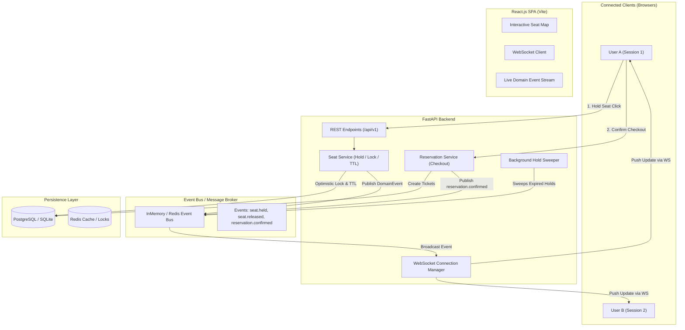

# 🎟️ Event-Driven Ticket & Seat Reservation System

A high-concurrency, event-driven web application for real-time ticket booking and interactive seat reservations, built with **FastAPI** (Python 3.11+) and **React.js** (Vite + Tailwind CSS).

---

## ⚡ Architecture Overview



---

## 🌟 Key Features

1. **Optimistic Locking & Concurrency Control**:
   - Prevents double-booking race conditions when multiple users click the same seat simultaneously.
2. **Temporary Seat Holds (TTL Locks)**:
   - Selecting a seat reserves it temporarily for a configurable duration (default: 5 minutes) while the user completes checkout.
   - Background worker sweeps expired holds and returns seats to `available` state automatically.
3. **Pluggable Event Bus**:
   - **In-Memory Async Event Bus**: Zero external dependencies, ideal for instant local development and unit tests.
   - **Distributed Redis Event Bus**: Ready for multi-worker containerized deployment and horizontal scaling.
4. **Real-Time Push Updates via WebSockets**:
   - When any user locks or releases a seat, or confirms a reservation, all other connected users viewing the seat map see immediate live color updates.
5. **Live Domain Event Stream UI**:
   - Real-time audit feed showcasing domain events (`seat.held`, `seat.released`, `reservation.confirmed`).

---

## 📁 Project Structure

```
event_driven_ticket_reservation/
├── backend/
│   ├── app/
│   │   ├── api/
│   │   │   ├── v1/
│   │   │   │   ├── events.py          # /api/v1/events endpoints
│   │   │   │   ├── seats.py           # /api/v1/events/{id}/seats (hold & release)
│   │   │   │   ├── reservations.py    # /api/v1/events/{id}/reservations/confirm
│   │   │   │   ├── ws.py              # WebSocket endpoint (/ws/events/{id})
│   │   │   │   └── router.py          # Aggregated API router
│   │   │   └── deps.py                # Dependency injection
│   │   ├── core/
│   │   │   ├── config.py              # Settings & env variables
│   │   │   ├── database.py            # Async SQLAlchemy engine & session maker
│   │   │   ├── events.py              # Domain events & EventBus implementations
│   │   │   └── websocket_manager.py   # ConnectionManager for real-time broadcasts
│   │   ├── models/                    # SQLAlchemy ORM models (Event, Seat, Reservation, Ticket)
│   │   ├── schemas/                   # Pydantic schemas (DTOs & requests/responses)
│   │   ├── services/
│   │   │   ├── seat_service.py        # Seat locking logic & domain event dispatch
│   │   │   ├── reservation_service.py # Ticket creation & confirmation
│   │   │   └── background_worker.py   # Expired seat hold sweeper
│   │   ├── db/
│   │   │   └── init_db.py             # Pre-seeds demo concert & 60-seat venue
│   │   └── main.py                    # FastAPI application & lifespan
│   ├── Dockerfile
│   ├── requirements.txt
│   └── run.py
│
├── frontend/
│   ├── src/
│   │   ├── api/
│   │   │   └── client.js              # REST API client & session manager
│   │   ├── components/
│   │   │   ├── Navbar.jsx             # Top bar, connection badge & session switcher
│   │   │   ├── SeatMap.jsx            # Interactive grid with VIP/Premium/Standard tiers
│   │   │   ├── HoldTimer.jsx          # Live countdown timer for active holds
│   │   │   ├── CheckoutModal.jsx      # Checkout form & digital ticket codes display
│   │   │   └── ActivityFeed.jsx       # Real-time domain event log viewer
│   │   ├── hooks/
│   │   │   └── useEventWebSocket.js   # WebSocket integration hook
│   │   ├── App.jsx                    # Main application orchestration
│   │   └── index.css                  # Tailwind styles
│   ├── Dockerfile
│   ├── package.json
│   └── vite.config.js
│
├── docker-compose.yml                 # Backend + Frontend + Redis + Postgres orchestration
└── README.md
```

---

## 🚀 Quick Start Guide

### Option A: Run with Docker Compose (Recommended)

Run everything (FastAPI, React, Redis, PostgreSQL) with one command:

```bash
docker compose up --build
```

- **Frontend**: http://localhost:3000
- **Backend API Docs (Swagger)**: http://localhost:8000/docs
- **Health Check**: http://localhost:8000/health

---

### Option B: Run Locally Without Docker

#### 1. Backend Setup

```bash
cd backend

# Create and activate virtual environment
python -m venv venv
# On Windows:
.\venv\Scripts\activate
# On Linux/macOS:
# source venv/bin/activate

# Install dependencies
pip install -r requirements.txt

# Run the backend (defaults to SQLite async & in-memory event bus)
python run.py
```
Backend will start on `http://localhost:8000`. Demo event data and seats are automatically seeded on startup!

#### 2. Frontend Setup

```bash
cd frontend

# Install packages
npm install

# Start Vite dev server
npm run dev
```
Frontend will start on `http://localhost:5173`.

---

## 🧪 Testing Concurrency & Real-Time Sync

To see the event-driven system in action:
1. Open `http://localhost:5173` in **two separate browser windows** (or one normal tab and one Incognito tab).
2. Each tab will automatically get a distinct `session_id` shown in the top navbar.
3. Click an available seat in Tab 1:
   - In **Tab 1**, the seat turns **Blue/Indigo** ("Selected by You") and starts a 5-minute countdown.
   - Instantly in **Tab 2**, that exact seat turns **Orange** ("Locked by Someone Else") with a lock icon.
   - Both tabs show the `seat.held` event in the **Live Event Stream**.
4. In Tab 1, click "Checkout", enter your name and email, and confirm:
   - The reservation completes and unique ticket codes are generated.
   - In both tabs, the seat instantly turns into a permanent **Reserved/Sold** state.

---

## 🧭 Next Steps to Decide

Here are the key architectural decisions and extensions we can tackle next:

1. **Payment Gateway Integration**:
   - Integrate Stripe, PayPal, or mock payment webhooks using an asynchronous payment processing flow (`payment.initiated` -> `payment.succeeded` -> `ticket.issued`).
2. **Distributed Locking with Redis (Redlock)**:
   - Upgrade the seat holding logic to use Redis atomic keys with TTL (`SET seat:{id}:lock {session_id} NX PX {ttl}`) for high-throughput distributed microservice clusters.
3. **Kafka or RabbitMQ Message Broker**:
   - Swap or extend the Event Bus to Apache Kafka or RabbitMQ for persistent event sourcing and consumer groups.
4. **Transactional Outbox Pattern**:
   - Implement an Outbox table to guarantee reliable event delivery even if the message broker is temporarily unreachable.
5. **User Authentication & Profiles**:
   - Add JWT-based auth (FastAPI OAuth2) so users have persistent ticket wallets and order histories.
